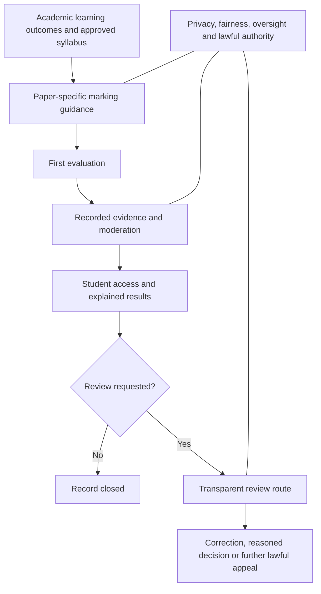

# PU-ETF

## Panjab University Evaluation & Transparency Framework

**Independent research in higher-education assessment, procedural fairness and institutional governance**  
**Status: Working policy framework · 2026 · Not institutionally adopted or validated**

> **Research question:** When a student challenges an examination result, can an institution explain *how marks were awarded*, preserve the underlying evidence, and offer a fair, timely, reviewable process—without turning a marking dispute into an unaccountable administrative loop?

**PU-ETF** is an independent student-authored policy and administrative-design initiative exploring how university evaluation can become more consistent, transparent, evidence-based and reviewable. It considers marking standards, partial-credit treatment, examiner moderation, access to evaluated work, grievance and re-evaluation processes, and carefully governed use of digital assessment systems.

The project is **not** an official Panjab University framework, an approved academic regulation, a commissioned study, a confirmed pilot, or evidence that the proposed changes would improve examination outcomes. “Panjab University” identifies the institutional context being studied, **not sponsorship or affiliation of this independent reform project**.

### Current development status

The author reports that the privately maintained working manuscript has expanded **beyond 400 pages**. An earlier public project summary referenced a 276-page draft. The present 400+ figure is **author-reported and not independently audited from the latest master manuscript**. Because the text is undergoing revision, **no original PDF, manuscript chapter, private grievance record or correspondence is included in this repository**. The files here are public-facing project documentation, not the working draft itself.

## Explore the research

| Section | What it covers |
|---|---|
| [Research question & scope](docs/01-research-question-and-scope.md) | Problem framing, goals, exclusions and assumptions |
| [Proposed framework architecture](docs/02-framework-architecture.md) | How evaluation, review, oversight and evidence could relate |
| [Marking standards and partial credit](docs/03-marking-standards.md) | Criteria clarity, alternate valid reasoning, question-level recording |
| [Examiner moderation and calibration](docs/04-examiner-moderation.md) | Consistency, oversight, training, drift and workload questions |
| [Student access, review and appeals](docs/05-student-rights-and-appeals.md) | Access to records, review grounds, timelines and procedural fairness |
| [Digital safeguards](docs/06-digital-evaluation-safeguards.md) | Auditability, privacy, human control and continuity |
| [Proposed pilot and evaluation plan](research/pilot-and-validation-plan.md) | A hypothetical limited pilot; **not** results |
| [Research methodology](research/methodology.md) | Source categories, comparison methods and study limitations |
| [Evidence and claims register](research/claims-and-evidence.md) | What is supported, reported, proposed or unverified |
| [Open questions](research/open-questions.md) | Areas requiring subject expertise and independent scrutiny |
| [Development roadmap](ROADMAP.md) | Proposed next research stages, no completion promises |
| [Project status](PROJECT_STATUS.md) | Version, evidence level and public/private boundaries |

## Policy-design areas

1. **Clear assessment criteria:** Explain the evidence expected for an answer and how alternative valid solutions receive credit.
2. **Examiner consistency:** Explore moderation, calibration, subject-specific judgement, quality assurance and appropriate workloads.
3. **Student access to evidence:** Consider access to evaluated answer books and understandable question-level scoring.
4. **Procedurally fair review:** Distinguish administrative error correction, rechecking, second evaluation, appeal and institutional accountability.
5. **Auditable digital processes:** Explore traceable on-screen marking, access controls, privacy, vendor independence and usable manual fallback.
6. **Evidence before policy adoption:** Design a limited, subject-diverse pilot with explicit legal authority, costs, risks, reliability measures and stop conditions.

### How the pieces relate

*Illustrative governance workflow, not an implemented PU procedure or software system.*

## What this repository does not claim

- No formal approval, adoption, funding, implementation or pilot partnership with Panjab University or any other institution.
- No representative study showing actual examiner error rates, inter-rater reliability, student benefit or fiscal savings.
- No assertion that an individual disputed assessment establishes a university-wide pattern.
- No publication of any identifiable student's answer book, marks, RTI records, grievance file or institutional correspondence.
- No guarantee that proposals are legal, affordable or appropriate across all disciplines and assessment types.

A proposal can be carefully constructed **without yet being empirically validated**. That distinction is central to PU-ETF.

## Source and authorship

**Author:** Harkeerat Singh · Independent project · 2026 onward. The existing [public project case study](https://github.com/iharkeerat/harkeerat-singh/blob/main/docs/case-studies/pu-evaluation.html) provides an earlier summary of the work. This repository updates the **public documentation**, not the private master proposal.

Drafting and documentation may be AI-assisted under author direction; see [Authorship and use of digital tools](research/methodology.md). For citation and reuse, see [CITATION.cff](CITATION.cff) and [Rights and reuse](RIGHTS_AND_REUSE.md).

**An explainable evaluation process should be designed to protect both academic judgement and the student's right to meaningful review.**