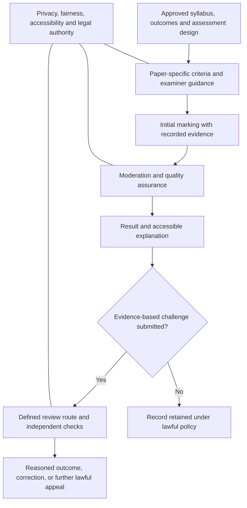

# 2 · Proposed framework architecture

The following is a **conceptual map for study**, not a Panjab University regulation or approved administrative pathway.

## Six research workstreams

| Workstream | Central design problem | Evidence needed before adoption |
|---|---|---|
| Marking criteria | How specific can criteria be without penalising valid alternatives? | Faculty review, sample scripts, disciplinary calibration |
| Examiner quality assurance | Which moderation practice gives useful consistency at manageable cost? | Inter-rater study, workloads, drift measures |
| Student access | What documents and explanations should students see? | Legal review, access burden, privacy and usability studies |
| Re-evaluation | Which review path matches which claimed error? | Error taxonomy, appeal data, procedural safeguards |
| Digital process | What audit trail is both meaningful and privacy preserving? | Security review, procurement assessment, fallback drills |
| Evaluation of reform | What would constitute success or harm? | Baseline measures, controlled pilot, independent assessment |

## Institutional caution

Responsibility, delegated authority, academic autonomy, and available review rights vary by institution and assessment type. No diagram in this repository overrides existing statutes, ordinances or court directions.
